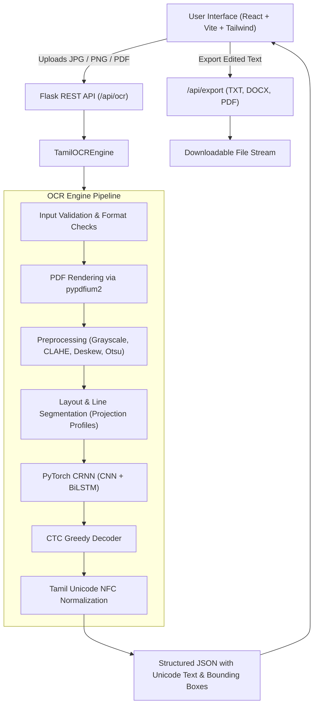

# System Architecture: TamilScript OCR

## 1. High-Level Overview

TamilScript OCR is a full-stack, modular platform designed for end-to-end recognition of handwritten and scanned Tamil script documents. The system provides complete page processing, line-level neural sequence modeling, Unicode reconstruction, and multi-format document export (TXT, DOCX, and PDF with embedded Tamil fonts).

## 2. Pipeline Subsystems

### A. Document Input & Ingestion
- Supported inputs: `.jpg`, `.jpeg`, `.png`, `.webp`, `.pdf` (including multipage PDFs).
- Enforces strict input validation: MIME verification, file size limits (25 MB), dimension limits (5000px max), and page count limits (20 pages max).
- Multipage PDFs are rendered page-by-page at 200 DPI into PIL Images using `pypdfium2`, requiring no external system dependencies such as Poppler.

### B. Preprocessing & Page Normalization
- **Grayscale Conversion:** Converts RGB images to luminance single-channel tensors.
- **Skew Estimation & Deskewing:** Employs minimum bounding area orientation analysis on text contours to calculate rotational skew (-30° to +30°) and corrects it via OpenCV affine transformation.
- **Contrast Enhancement:** Contrast Limited Adaptive Histogram Equalization (CLAHE) normalizes faded ink and uneven background lighting.
- **Binarization:** Gaussian blurring followed by Otsu adaptive thresholding segments text from paper fiber backgrounds.

### C. Layout Analysis & Text-Line Segmentation
- **Horizontal Projection Profiles:** Integrates vertical sums of horizontally dilated pixel ribbons to identify text-line baselines.
- **Tamil Diacritic Preservation:** Includes dynamic vertical padding to preserve upper pulli dots (`்`) on pure consonants (e.g., க், ங், ச்) and lower loops on dependent vowels (e.g., ு, ூ, ௹).
- **Reading Order Reconstruction:** Sorts identified lines top-to-bottom and left-to-right to maintain chronological reading order across the document.

### D. Deep Neural Sequence Recognition
- **Architecture:** CRNN (`TamilHandwrittenCRNN`):
  1. **7-Stage CNN Feature Extractor:** Convolutions with BatchNorm and ReLU reduce image height to 1 while preserving the horizontal time dimension.
  2. **Bidirectional Recurrent Modeling:** 2-layer BiLSTM (512 hidden dimension) captures bidirectional contextual dependencies across cursive character sequences.
  3. **CTC Linear Projection:** Projects sequence representations to Tamil vocabulary tokens (87 classes including blank).
- **CTC Decoding:** Collapses repeated activations, strips blank tokens (index 0), and decodes index sequences into Unicode Tamil strings.

### E. Unicode Reconstruction & Normalization
- All characters are decoded directly into valid Unicode Tamil block (`U+0B80` to `U+0BFF`).
- Enforces canonical Unicode Normalization Form C (`NFC`), ensuring composed characters and pulli marks are standardized.
- Strips carriage returns (`\r`) while preserving meaningful line breaks and spaces.

### F. Multi-Format Export Engine
- **TXT:** UTF-8 plain text preserving line breaks and character combinations.
- **DOCX:** Microsoft Word XML format via `python-docx` with paragraph formatting and cross-platform Tamil font preferences.
- **PDF:** ReportLab document generation with embedded Google `NotoSansTamil` TrueType font, supporting automatic text wrapping and multi-page pagination.
